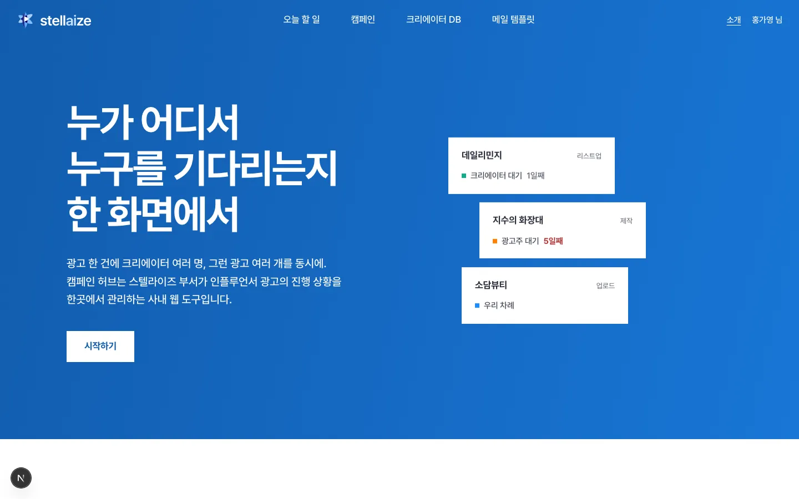
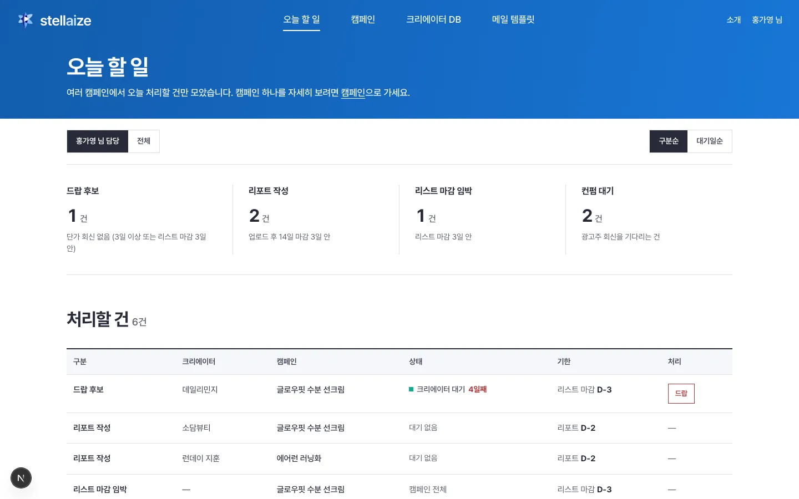
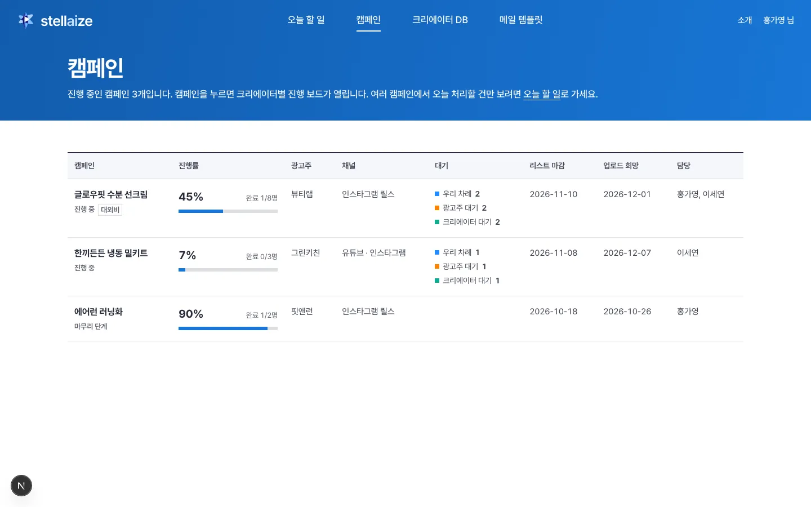
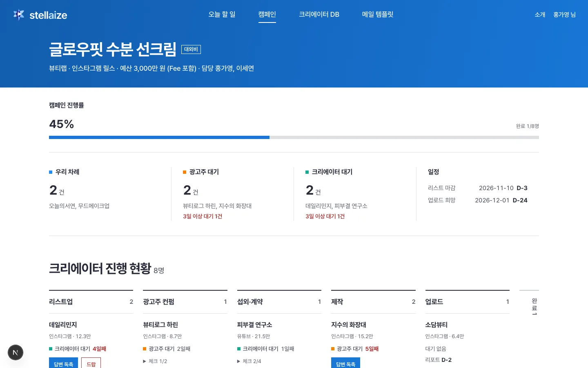
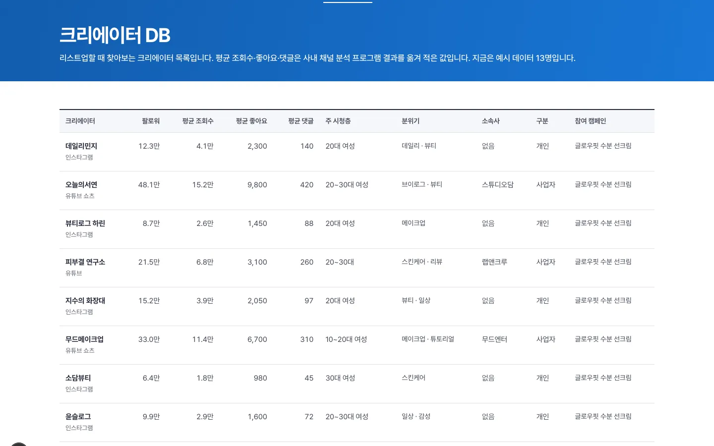
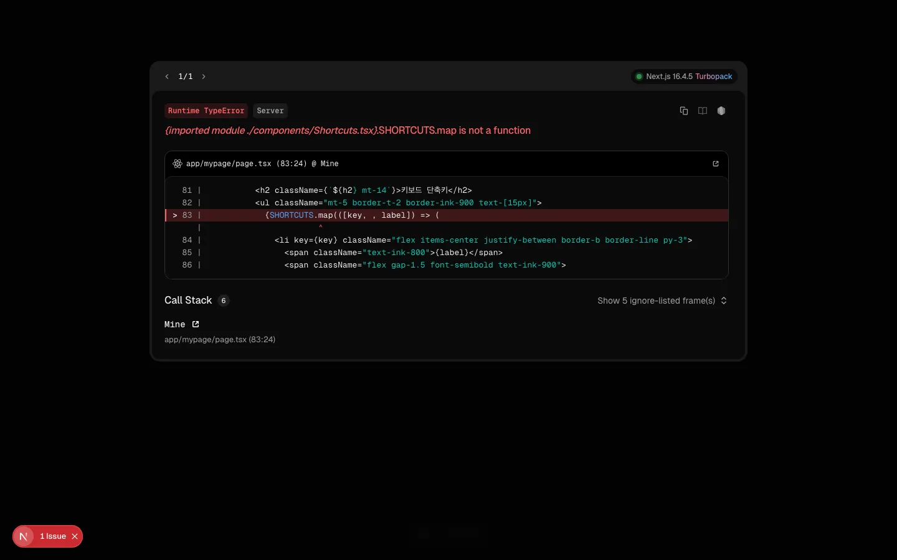

# Stellaize Campaign Hub

스텔라이즈 부서의 인플루언서 광고 운영 웹 도구.

> 광고 한 건에 크리에이터 여러 명, 그런 광고 여러 개를 동시에 진행한다. 어디까지 진행됐는지 매번 메일로 물어봐야 했다.
> 이 도구의 목표는 **"누가, 지금 어느 단계에서, 무엇을(누구를) 기다리고 있는지"**를 한 화면에서 보이게 하는 것.

- **만드는 사람:** 홍가영, 이세연
- **쓰는 사람:** 스텔라이즈 부서 운영 담당 3~4명 (사내 전용)
- **진행 흐름:** 광고주 의뢰 → 접수 → 리스트업 → 광고주 컨펌 → 섭외·계약 → 제작 → 업로드 → 완료
- **지금 상태:** 아래 화면 6개가 **예시 데이터**로 동작한다. 실제 데이터(Supabase)와 로그인은 아직 연결 전이다.

---

## 화면 둘러보기

| 화면 | 주소 | 하는 일 |
|---|---|---|
| **소개** | `/about` (첫 화면) | 이 도구가 무엇인지, 스텔라이즈 부서와 업무 흐름, 바뀌는 점. 처음 보는 사람용 |
| **오늘 할 일** | `/today` | 내가 맡은 **모든 캠페인**에서 오늘 처리할 건만 모은다: 드랍 후보, 리포트 작성, 리스트 마감 임박, 컨펌 대기 |
| **캠페인** | `/campaigns` | 캠페인 **목록**. 캠페인마다 크리에이터 수, 누구를 기다리는지, 마감일, 담당자 |
| **캠페인 보드** | `/campaigns/glowfit` 등 | 캠페인 **하나**의 크리에이터별 진행 칸반. 대기 주체·대기 일수, 단계별 체크리스트 |
| **크리에이터 DB** | `/creators` | 리스트업할 때 찾아보는 크리에이터 목록. 팔로워, 평균 조회수·좋아요·댓글, 주 시청층, 소속사, 참여 캠페인 |
| **마이페이지** | `/mypage` | 내 정보, 내 담당 캠페인, 비밀번호 변경(로그인 연결 후 사용) |

**"오늘 할 일"과 "캠페인"의 차이:** 오늘 할 일은 여러 캠페인을 가로질러 **할 일 위주**로 본다(아침에 여는 화면). 캠페인은 캠페인을 **하나씩** 골라 들어가서 크리에이터 전원의 진행 상황을 본다.

### 소개 (첫 화면)


### 오늘 할 일


### 캠페인 목록


### 캠페인 보드
대기 주체는 작은 네모 색(■ 파랑 = 우리 차례, 주황 = 광고주 대기, 초록 = 크리에이터 대기)과 글자로 표시한다. 3일 넘게 기다린 건은 일수가 빨간색이다.



### 크리에이터 DB


### 마이페이지


메일 템플릿, 용어 사전은 아직 없어서 "아직 만들지 않은 화면입니다" 안내가 뜬다.

---

## 내 컴퓨터에서 실행하기

**준비물:** [Node.js](https://nodejs.org) 20.9 이상(LTS 버전 설치 권장), Git. 터미널에서 `node -v`로 버전을 확인한다.

```bash
git clone https://github.com/iamhiki/stellaize-campaign-hub.git
cd stellaize-campaign-hub
npm install      # 처음 한 번만
npm run dev
```

브라우저에서 **http://localhost:3000** 을 열면 소개 화면이 먼저 뜬다. "시작하기"를 누르거나 상단 메뉴로 이동한다. 끄려면 터미널에서 `Ctrl+C`.

- 최신 내용 받기: `git pull` → `npm install` → `npm run dev`
- `Port 3000 is in use`가 나오면 이미 켜져 있는 것이다. 그대로 http://localhost:3000 을 열거나 `npm run dev -- -p 3001`로 다른 포트를 쓴다.
- 예시 데이터라 체크한 내용은 새로고침하면 사라진다. 날짜는 오늘 기준으로 자동으로 맞춰진다.
- 왼쪽 아래 검은 동그라미 "N"은 개발 모드에서만 보이는 Next.js 도구 버튼이다. 실제 배포 화면에는 나오지 않는다.

## 폴더 구성

```
app/about/            소개 (첫 화면)
app/today/            오늘 할 일
app/campaigns/        캠페인 목록, [id]/ 캠페인 보드
app/creators/         크리에이터 DB
app/mypage/           마이페이지
app/not-found.tsx     아직 없는 화면 안내
components/           상단 메뉴(SiteHeader), 파란 띠(PageBand), 칸반, 크리에이터 카드, 대기 상태 표시
lib/demo.ts           예시 데이터: 캠페인 3개, 크리에이터 13명, 담당자 홍가영·이세연 (Supabase 연결 시 교체)
lib/date.ts           D-day·대기 일수 계산 (한국 시간 기준). 자동 검사: node lib/date.check.ts
app/globals.css       색·폰트·애니메이션 (스텔라이즈 색 값)
docs/screens/         README 화면 캡처
PRODUCT.md            사용자, 목적, 브랜드 약속, 원칙
```

## 디자인 방향

- **인크로스 홈([incross.com/ko](https://incross.com/ko/))의 시각 언어**: 파란 띠 위 상단 메뉴와 촘촘한 큰 제목, 세로선으로 나눈 4칸 요약, 위 2px 진한 선과 1px 구분선으로 나눈 목록. 홈페이지처럼 큰 배너는 쓰지 않는다. 하루 종일 켜 두는 업무 화면이라 칸반이 첫 화면에 보여야 한다.
- **배경과 색은 [스텔라이즈](https://www.stellaize.com/)**: 브랜드 파랑 그라데이션, 스텔라이즈 회색 글자(`#282A3A`, `#404252`, `#5B5D6B`)와 구분선(`#DDDFE2`). 폰트는 두 사이트 공통인 Pretendard.
- **AI 앱처럼 보이지 않게**: Tailwind 기본 색·둥근 모서리·그림자를 테마에서 지워서 쓸 수 없게 했다. 알약 배지와 그림자 카드 대신 작은 네모(■)와 글자로 상태를 표시한다.
- **빨강은 문제일 때만**: 3일 이상 대기, 마감 D-1·당일·지남. 캠페인 공통 마감은 "일정" 칸에만 한 번 보여 주고 카드에는 반복하지 않는다.
- **휴대폰**: 메뉴는 옆으로 밀어 넘기고, 요약은 2칸, 칸반은 단계별로 위아래로 쌓인다.
- 사이트의 CSS·JS·이미지 파일은 복사하지 않고 값만 옮겼다. 로고는 공식 파일을 받기 전까지 글자 로고로 둔다.

---

## 데이터 모델

```
Campaign (캠페인)          1 ─── N  CampaignCreator (캠페인별 크리에이터 진행 건)  N ─── 1  Creator (크리에이터)
  광고주/브랜드/제품                   단계 · 세부상태 · 대기주체(광고주/크리에이터/우리)      채널 · 팔로워 · 평균 조회수
                                       대기 시작일(waiting_since) · 실제 업로드일(uploaded_at)
  예산(NET/Fee 포함 여부)               견적(1건가 · 2차활용가) · 제안가                      주 시청층 · 소속사 · 연락처
  채널 · 업로드 희망일                   서류 · 계약 · 배송 · 콘텐츠 버전 · 리포트 작성 여부      사업자/개인 구분 · 광고 이력
  대외비 여부 · 담당자(3~4명)
```

`CampaignCreator` 가 이 앱의 중심 엔티티다. 캠페인이 아니라 **크리에이터 × 캠페인** 단위로 단계를 추적한다.

`waiting_since` 는 대기주체가 바뀔 때 자동으로 오늘 날짜가 된다. "오늘 할 일"의 업로드 +14일 계산은 `uploaded_at` 을 쓴다.

---

## 기능 구성

### MVP (1차)

| # | 기능 | 설명 | 대응 업무 |
|---|------|------|-----------|
| 1 | **캠페인 등록 (접수)** | 광고주·브랜드·제품, 예산, 채널, 업로드 희망일, 리스트 마감일, 원하는 스타일 입력. **NET/Fee 포함 여부**, **대외비** 체크 필수 항목 | 01 접수 |
| 2 | **크리에이터 DB** | 팔로워, 평균 조회수·좋아요·댓글 수(사내 채널 분석 프로그램 결과를 입력), 주 시청층, 분위기 태그, 소속사, 사업자/개인. 캠페인별 과거 단가 이력 | 02 제안 |
| 3 | **캠페인 보드 (칸반)** | 컬럼 = 리스트업 → 광고주 컨펌 → 섭외·계약 → 제작 → 업로드 → 완료. 카드 = 크리에이터. 카드에 **"대기 중: 광고주 / 크리에이터 / 우리"** 배지. 진행 건 상세 화면 상단에 같은 단계를 진행 표시줄(흐름도)로 표시 | 핵심 포인트 |
| 4 | **단계별 체크리스트** | 각 단계의 하위 항목(단가 회신, 피저체크, 서류 수령, 날인본, 기획안→초안→수정본→최종본 컨펌, 링크·PA코드, 리포트 작성 완료)을 카드 안에서 체크 | 04 단계별 |
| 5 | **콘텐츠 버전 기록** | 버전마다 파일/링크 · 광고주 피드백 · 크리에이터에게 전달 여부를 한 줄씩 기록. 크리에이터 → 우리 → 광고주 → 우리 → 크리에이터로 오갈 때 대기주체가 바뀐다 | 제작 |
| 6 | **"오늘 할 일" 대시보드** | 내 담당 캠페인 전체에서: 리스트 마감일까지 단가 회신 없는 건(드랍 후보), 업로드 +14일 도래(리포트 작성 대상), 리스트 마감 임박, 컨펌 대기 건 | 03 리마인드 |
| 7 | **단가 견적 & 제안가 계산** | 1건가 / 2차활용가 / 업로드 가능일 / 테스트 기간 / 성과 제공 / 세금계산서 가능 여부 입력 → 수수료율 적용한 **제안가 자동 계산**. 계산 규칙은 아래 "제안가 계산 규칙" 참고 | 02 제안 |

단가 문의에 회신이 없는 크리에이터는 리마인드하지 않고 제안에서 뺀다(드랍).
성과 리포트는 스텔라이즈 플랫폼에서 작성하므로 이 앱은 작성 여부만 체크한다.

### 2차

| # | 기능 | 설명 |
|---|------|------|
| 8 | **메일 템플릿 4종** | 단가 문의 · 부킹 요청 · 인사이트 요청 · 드랍 안내. 캠페인/크리에이터 정보 자동 치환, **팀메일 참조 자동 포함**, 첨부 필요 시 발송 전 확인 경고 |
| 9 | **후보 리스트 내보내기** | 광고주용 후보 리스트를 제안가 기준으로 엑셀/시트로 export (NET 단가는 숨김) |
| 10 | **계약서 자동 기입** | 확정 금액·과업·일정으로 계약서 PDF 생성, 날인본 업로드 및 **누락 페이지 체크** |
| 11 | **정산 관리** | 사업자 → 세금계산서 발행 확인 / 개인 → 3.3% 원천징수 자동 계산, 지급 예정일 |
| 12 | **경쟁사 광고 이력 체크** | 크리에이터별 최근 3개월 광고 브랜드/카테고리 기록 → 리스트업 시 충돌 경고 |

### 3차 (협업 · 연동)

| # | 기능 | 설명 |
|---|------|------|
| 13 | **슬랙 연동** | 신규 인입 메시지 → 캠페인 초안 생성 / 단계 완료 시 운영방에 자동 업데이트 |
| 14 | **위클리 자동 초안** | 한 주 활동 로그를 '제안 / 운영 / 기타'로 묶어 위클리 초안 생성 |
| 15 | **대무 모드** | 담당자 부재 시 캠페인 인계: 현재 상태 요약 + 대기 건 목록을 한 페이지로 |
| 16 | **구글 시트 가져오기** | 기존 시트 데이터 마이그레이션 |
| 17 | **용어 사전** | 신규 입사자용 용어집 (인입, 피저체크, 드랍, PA 광고코드 등) 툴팁 |

1~2차의 자동화(마감 표시, +14일 알림, 제안가 계산, 템플릿 치환)는 날짜·규칙 계산이라 AI가 필요 없다. AI 연동이 필요한 것은 3차의 13·14번 정도이며, 운영 관리 기능을 먼저 만든 뒤 결정한다.

---

## 화면 구성 (✓ = 예시 데이터로 만듦)

```
/                      → /about 소개로 이동                                ✓
/about                 소개 (첫 화면)                                      ✓
/today                 오늘 할 일 대시보드                                 ✓
/campaigns             캠페인 목록 (담당자 필터는 아직)                     ✓
/campaigns/:id         캠페인 상세 = 크리에이터 칸반 보드 + 캠페인 정보       ✓
/campaigns/:id/c/:cid  크리에이터 진행 건 상세 (진행 표시줄, 체크리스트, 견적, 서류, 콘텐츠 버전, 타임라인)
/creators              크리에이터 DB (검색/필터는 아직)                     ✓
/mypage                마이페이지 (로그인 연결 전)                          ✓
/templates             메일 템플릿
/glossary              용어 사전
```

## 기술 스택

- 웹앱 (.exe 아님: 여러 명이 같은 데이터를 동시에 본다)
- Next.js 16 (App Router) + TypeScript + Tailwind v4 — 적용됨
- Supabase (Postgres, Auth, Storage — 계약서/서류 파일) — 아직 연결 전
- 배포: Vercel — 아직 연결 전

## 제안가 계산 규칙 (팀 확인 필요)

구현 전에 아래 세 가지를 정하고, 정한 숫자 예시를 테스트로 남긴다.

- 수수료 방식: 얹기(크리에이터 단가 × 1.2) 또는 떼기(÷ 0.8). 단가 100만 원이면 120만 원 / 125만 원으로 갈린다.
- 부가세: 제안가에 포함인지 별도인지
- 반올림: 원 단위 처리 방식 (예: 만 원 단위 올림)

## 기획자 질의응답 (2026-11-07)

| # | 질문 | 답 | 반영 |
|---|---|---|---|
| 1 | 단가 문의에 확답을 받을 때까지 계속 리마인드하나? | 회신이 없으면 그 크리에이터는 빼고 광고주에게 제안한다. | 리마인드 대신 "드랍 후보"로 표시 |
| 2 | 리스트업할 때 인플루언서 채널 분석 수단이 있나? | 사내 개발팀 프로그램에 URL을 넣으면 평균 조회수·좋아요·댓글 수가 나온다. 리스트업 때 같이 기재한다. | 앱에서 계산하지 않고 결과를 입력 |
| 3 | 기획안 → 초안 → 수정본 → 최종본은 누가 받고 누가 전달하나? | 크리에이터가 우리에게 초안을 주고, 우리가 광고주에게 전달해 컨펌받은 뒤 크리에이터에게 피드백을 전달한다. | 콘텐츠 버전 기록(MVP 5), 대기 주체가 오갈 때마다 바뀜 |
| 4 | 성과·정산의 "도달"은 무엇인가? | 조회수는 끝까지 봐야 집계되고, 도달은 클릭률에 가깝다. 다만 성과 단계는 했다/안 했다만 체크하면 된다. 리포트는 광고주도 보는 스텔라이즈 플랫폼에서 작성한다. | 성과 리포트 기능 삭제, "리포트 작성 완료" 체크만 |
| 5 | 관리 기능만 필요한가, 자동화까지 갈 것인가? | 상관없지만, 자동화하려면 AI 연동이 필요할 확률이 높지 않나? | 1~2차 자동화는 날짜·규칙 계산이라 AI 불필요. AI는 3차에서 결정 |

## 확인 필요 질문

- 사내 채널 분석 프로그램(URL을 넣으면 평균 조회수·좋아요·댓글 수가 나오는 것)에 다른 프로그램이 데이터를 가져다 쓸 수 있는 API가 있는가? 있으면 크리에이터 DB에 직접 입력하는 대신 자동으로 불러온다. (개발팀에 문의)
- 며칠째 기다리면 경고(빨간색)로 볼 것인가? 지금은 대기 3일 이상, 마감 D-1부터로 임시 지정했다.
- 대외비 캠페인의 예산을 칸반 화면 맨 위에 그대로 보여도 되는가? 지금은 그대로 보인다.
- 업로드 후 리포트 작성은 "우리 차례"로 볼 것인가? 지금 예시 데이터에서는 리포트 마감이 다가와도 "대기 없음"으로 나온다.

## 주의 사항

- 대외비 브랜드는 캠페인 담당자 외 비노출. 화면마다 가리지 않고 Supabase RLS(행 단위 접근 제어)로 `Campaign` 테이블에서 막는다. 크리에이터 DB의 과거 단가 이력·광고 이력도 같은 테이블을 거치므로 함께 가려진다.
- 크리에이터 개인정보(신분증, 통장 사본, 주소)는 Storage 접근 제어 필수, 정산 완료 후 보관 기한 정책 필요
- 주민등록번호 등 고유식별정보는 암호화해서 저장하고 화면에는 가려서 표시 (개인정보보호법)
