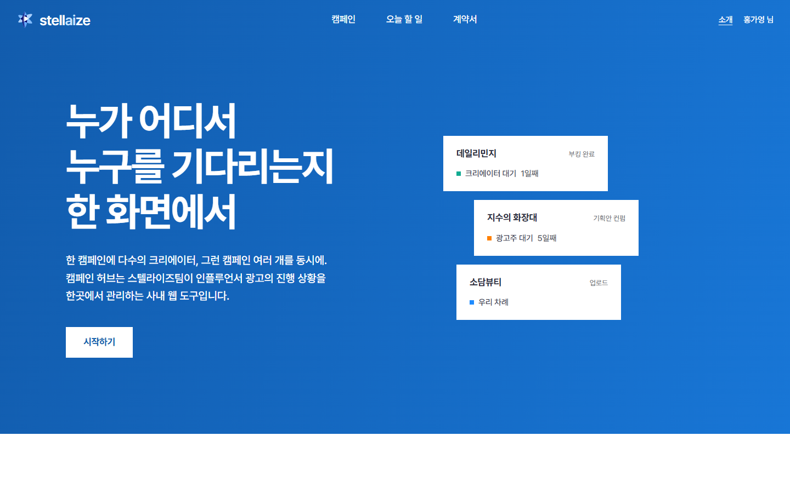
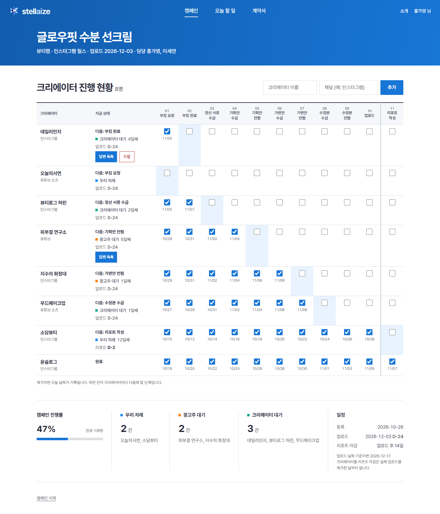
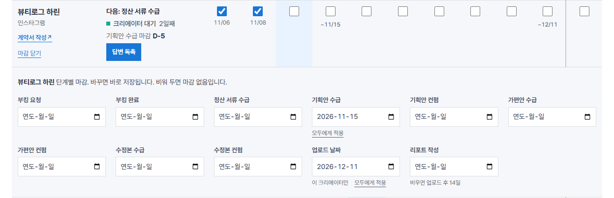
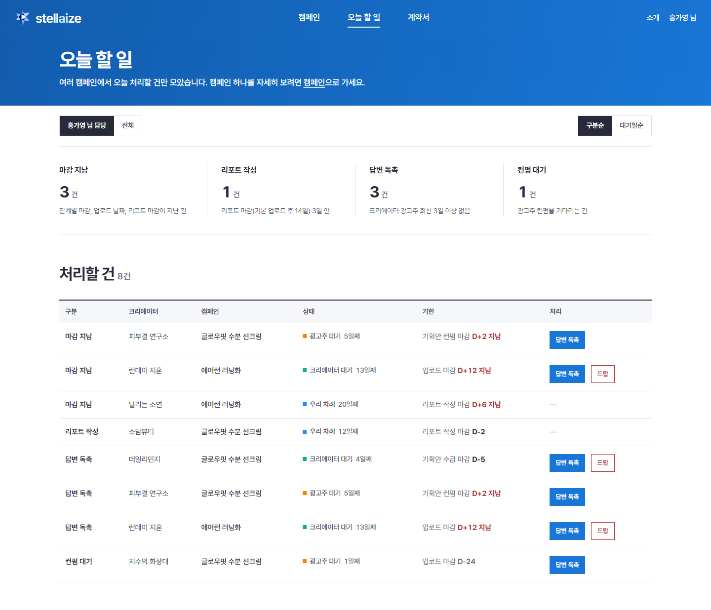
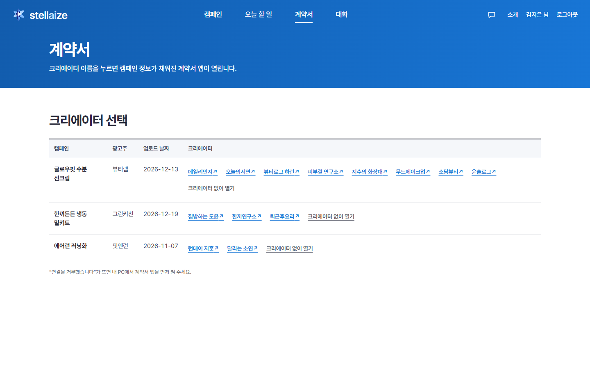
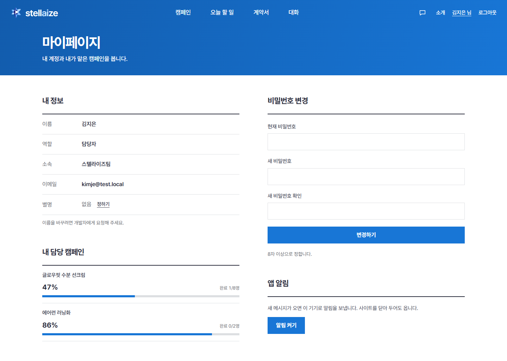

# Stellaize Campaign Hub

스텔라이즈팀의 인플루언서 광고 운영 웹 도구.

> 한 캠페인에 다수의 크리에이터, 그런 캠페인 여러 개를 동시에 진행한다. 어디까지 진행됐는지 매번 메일로 물어봐야 했다.
> 이 도구의 목표는 **"누가, 지금 어느 단계에서, 무엇을(누구를) 기다리고 있는지"**를 한 화면에서 보이게 하는 것.

- **만드는 사람:** 홍가영, 이세연
- **쓰는 사람:** 스텔라이즈팀 운영 담당 3~4명. 초대받은 크리에이터는 자기 일정 화면만 본다(기획자 요청 11/11)
- **업무 흐름:** 접수 → 리스트업 → 부킹 → 제작 → 업로드 → 리포트 작성 → 완료
- **크리에이터별 진행 단계:** 부킹 요청 → 부킹 완료 → 정산 서류 수급 → 기획안 수급 → 기획안 컨펌 → 가편안 수급 → 가편안 컨펌 → 수정본 수급 → 수정본 컨펌 → 업로드 → (리포트 작성)
- **지금 상태:** 로그인해서 쓴다. 입력한 내용은 Supabase를 연결했으면 **Supabase**에, 연결하지 않았으면 **허브를 켠 컴퓨터의 `data/hub.json` 파일**에 저장된다(아래 "Supabase 연결"). 같은 서버에 접속한 사람은 모두 같은 데이터를 본다. 처음 켜면 예시 캠페인 3개가 들어 있다. 마감 알림 **메일은 아직 보내지 않는다**(크리에이터 화면에만 표시).
- **최근 변경:** 2026-11-11 기획자 요청 반영: 답변 독촉 버튼 삭제, 담당자·크리에이터 로그인, 크리에이터 링크 제출, 마감 알림 (아래 "계정과 크리에이터 화면" 참고)

---

## 화면 둘러보기

담당자의 상단 메뉴는 **캠페인 · 오늘 할 일 · 계약서** 세 개다. 오른쪽 위에 소개, 마이페이지, 로그아웃이 있다. 크리에이터에게는 **내 일정** 하나만 보인다. 개발자 계정은 담당자 메뉴에 **크리에이터 화면**이 하나 더 있다. 로그인 전에는 오른쪽 위에 소개와 로그인만 있고, 소개 화면 첫 구역 아래에 담당자·크리에이터 로그인 안내가 있다.

| 화면 | 주소 | 하는 일 |
|---|---|---|
| **소개** | `/about` (첫 화면) | 이 도구가 무엇인지, 스텔라이즈팀과 업무 흐름, 바뀌는 점. 처음 보는 사람용 |
| **캠페인** | `/campaigns` | 캠페인 **목록**(캠페인 이름, 광고주, 채널, 업로드 날짜, 담당자, 진행률)과 **캠페인 등록** |
| **캠페인 상세** | `/campaigns/glowfit` 등 | 맨 위에 **크리에이터 진행 현황 표**. 크리에이터마다 단계별 체크칸, 다음 단계, 대기 주체·일수, 마감. 아래에 진행률·대기 요약·일정 |
| **오늘 할 일** | `/today` | 여러 캠페인에서 오늘 처리할 건만 모은다: 마감 지남, 리포트 작성, 회신 지연, 컨펌 대기. "내 담당 / 전체" 필터, "구분순 / 대기일순" 정렬 |
| **계약서** | `/contracts` | 계약서 자동작성 앱 사용 순서, 캠페인·크리에이터를 골라 앱 열기. 크리에이터 진행 표의 이름 아래 **계약서 작성** 링크도 같은 일을 한다 |
| **마이페이지** | `/mypage` | 내 정보, 내 담당 캠페인과 진행률, 비밀번호 변경 |
| **로그인 · 회원가입** | `/login`, `/signup` | 이메일과 비밀번호로 로그인. 회원가입은 로그인 화면의 버튼으로 간다. 담당자는 팀 가입 코드, 개발자는 개발자 코드로 가입 |
| **크리에이터 초대** | `/join?t=…` | 담당자가 만든 초대 링크. 크리에이터가 가입하면 그 캠페인의 자기 행에 연결된다 |
| **내 일정** (크리에이터) | `/creator` | 참여 캠페인의 단계·마감·상태, 기획안·가편안·수정본 링크 제출, 지난 마감 알림. 개발자 계정으로 열면 크리에이터를 골라 보는 미리보기(보기 전용) |

**캠페인 등록:** 캠페인 목록의 **+ 캠페인 등록**에서 캠페인 이름, 광고주, 채널, 업로드 날짜, 담당자를 넣는다. 저장하면 그 캠페인 화면이 열리고, 크리에이터 이름과 채널을 넣어 추가한다. 여기서 넣는 업로드 날짜는 크리에이터 전원의 기본값이다.

**진행 체크:** 크리에이터마다 단계가 끝나면 체크한다. 체크한 날짜(한국 시간)가 칸 아래에 남는다. 아직 안 한 첫 단계가 "다음 단계"이고 파란 칸으로 표시된다. 다음 단계에 따라 대기 주체가 정해진다.
- 우리 차례: 부킹 요청, 리포트 작성
- 크리에이터 대기: 부킹 완료, 정산 서류 수급, 기획안·가편안·수정본 수급, 업로드
- 광고주 대기: 기획안·가편안·수정본 컨펌

대기 일수는 마지막으로 체크한 날부터 센다.

**단계별 마감·크리에이터별 업로드 날짜:** 크리에이터 이름 아래 **마감 설정**을 누르면 11단계 각각의 마감 날짜 칸이 열린다. 바꾸면 바로 저장되고, 체크칸 아래에 "~11/20"처럼 표시된다.
- 업로드 날짜를 넣으면 그 크리에이터만 그 날짜를 쓴다. 비워 두면 캠페인 업로드 날짜를 쓴다. 계약서 앱에도 이 날짜가 넘어간다.
- 리포트 작성은 비워 두면 업로드 체크일 + 14일이다.
- **모두에게 적용**을 누르면 같은 단계 마감을 캠페인의 다른 크리에이터에게도 넣는다(기획안 마감처럼 다 같은 경우).
- "지금 상태"에는 아직 체크 안 한 단계 중 가장 가까운 마감이 나온다.

**진행률:** 체크한 칸 수 ÷ (크리에이터 수 × 11단계). 드랍한 크리에이터는 빼고 계산한다. 옆에 모든 단계를 마친 인원("완료 1/8명")을 적는다.

**빨간색 = 마감이 지난 건만:** 아직 체크하지 않은 단계의 마감(단계별 마감, 업로드 날짜, 리포트 마감)이 지났을 때 빨간색으로 "D+n 지남"을 표시한다. 캠페인 목록과 요약에 마감 지난 건수를 모은다.

**회신 지연·드랍:** 크리에이터나 광고주 회신이 3일 이상 없으면 오늘 할 일의 "회신 지연"에 모인다. 연락은 카톡·메일·전화로 허브 밖에서 한다. 크리에이터에게는 **[드랍]**도 나온다. 드랍은 한 번 더 확인한 뒤 빼고, 표 아래 "드랍" 목록에서 **되돌리기**할 수 있다.
- 답변 독촉 버튼(독촉한 날만 기록)은 기획자 요청(11/11)으로 뺐다. 알림을 보내지 않는 기록용이라 쓸 일이 없었다.

## 계정과 크리에이터 화면 (기획자 요청 2026-11-11)

기획자 요청: 크리에이터도 가입해서 들어오게, 기획안·가편안·수정본을 플랫폼에서 받게, 협의한 일정의 마감을 안 지키면 알림이 가게. 단, 크리에이터는 우리가 관리하는 화면은 못 보고 자기 할 일만.

**계정은 세 가지다.**

| 계정 | 가입 방법 | 보는 화면 |
|---|---|---|
| **담당자** | `/signup`의 가입 코드 칸에 **팀 가입 코드** | 캠페인, 오늘 할 일, 계약서, 마이페이지 |
| **개발자** | `/signup`의 가입 코드 칸에 **개발자 코드** | 담당자 화면 전부 + 크리에이터 화면 미리보기 |
| **크리에이터** | 담당자가 보낸 **초대 링크** | 내 일정 하나 |

- **담당자:** 가입할 때 넣는 이름이 캠페인 담당자 칸의 이름과 같아야 "내 담당"에 모인다.
- **개발자:** 허브를 만드는 사람용이다. 담당자와 똑같이 등록·체크할 수 있고, 상단 메뉴의 **크리에이터 화면**에서 크리에이터를 고르면 그 사람이 로그인했을 때 보는 내 일정이 나온다(아직 가입하지 않은 크리에이터도 고를 수 있다). 미리보기는 보기 전용이라 링크 제출은 할 수 없다. 제출까지 해 보려면 초대 링크를 시크릿 창에서 열어 크리에이터로 가입한다.
- **크리에이터:** 따로 가입할 수 없다. 담당자가 캠페인 상세의 크리에이터 행에서 **마감 · 초대 → 초대 링크 만들기**로 만든 주소를 보내고, 크리에이터가 그 주소에서 가입한다. 링크는 한 사람이 가입하면 더 쓸 수 없다. 이미 계정이 있는 크리에이터는 같은 링크에서 로그인해 캠페인을 추가한다.

**가입 코드는 허브를 설치한 사람이 정한다.** 화면에서 바꾸는 기능은 없다.
- 프로젝트 폴더의 `.env.local`에서 `STAFF_JOIN_CODE=`(팀 가입 코드)와 `DEV_JOIN_CODE=`(개발자 코드) 뒤의 값을 정한다. 저장하면 적용되고, 안 바뀌면 서버를 껐다 켠다.
- 정한 코드는 가입할 사람에게 따로 알려 준다. 가입할 때 한 번만 쓴다.
- 코드는 가입할 때만 확인한다. 코드를 바꿔도 이미 가입한 계정은 그대로다. 코드가 새어 나갔으면 바꾸면 된다.
- 값을 비워 두면 그 종류의 가입이 막힌다. 팀원이 모두 가입한 뒤 잠가 둘 때 쓴다.
- `.env.local`은 git에 올라가지 않는다. 다른 PC나 서버에 설치하면 거기서 새로 만든다.

**크리에이터가 보는 것:** 연결된 자기 행의 부킹 요청 ~ 업로드 단계, 단계별 마감과 D-day, 지금 누구 차례인지, 자기가 낸 링크뿐이다. 다른 크리에이터, 담당자 이름, 리포트 작성 단계, 다른 캠페인은 서버가 보내지 않는다. 담당자 화면 주소를 직접 쳐도 내 일정으로 돌아간다.

**링크 제출:** 크리에이터가 기획안·가편안·수정본 칸에 링크(드라이브, 유튜브 일부 공개 등)와 메모를 넣어 제출하면, 그 "수급" 단계가 오늘 날짜로 체크되고 담당자 표의 그 칸에 **제출본↗**이 붙는다. 다시 제출하면 "제출본 2"처럼 횟수가 보이고 가장 최근 링크가 열린다. 파일 자체는 허브에 올리지 않는다(영상 용량, 보관 비용).

**마감 알림:** 가입한 크리에이터의 차례인 단계가 마감을 넘기면 크리에이터의 내 일정 화면 위에 빨간 안내가 뜨고, 담당자의 마감 · 초대 칸에 기록이 남는다. **메일·카톡 발송은 아직 없다.** 보낼 회사 메일 계정(또는 발송 서비스)과 카카오 비즈니스 채널이 정해져야 붙일 수 있다. 알림 기록에 "메일은 아직 보내지 않음"으로 남아 있어서, 발송이 붙으면 그 건부터 보낸다.

**크리에이터가 실제로 들어오려면** 허브가 크리에이터도 열 수 있는 주소(https)에 떠 있어야 한다. 지금처럼 내 PC에서 켠 `localhost:3000`의 초대 링크는 같은 PC에서만 열린다.

### 소개 (첫 화면)


### 캠페인 목록


### 캠페인 상세
대기 주체는 작은 네모 색(■ 파랑 = 우리 차례, 주황 = 광고주 대기, 초록 = 크리에이터 대기)과 글자로 표시한다.



**마감 설정**을 연 모습 (단계별 마감, 이 크리에이터의 업로드 날짜)



### 오늘 할 일


### 계약서


### 마이페이지


---

## 기획자 피드백 (2026-11-07)

| 항목 | 피드백 | 반영 |
|---|---|---|
| 소개 | "스텔라이즈 부서" → "스텔라이즈팀", 소개 문구와 업무 흐름 교체 | 접수 → 리스트업 → 부킹 → 제작 → 업로드 → 리포트 작성 → 완료 |
| 소개 | 캠페인당 인원이 1~50명으로 다양함 | "한 캠페인에 다수의 크리에이터" |
| 소개 | 3일 대기 → 마감 지난 건 빨간색 / 날짜 계산 문구 | 문구와 실제 규칙 모두 변경 |
| 메뉴 | 캠페인 · 오늘 할 일 · 계약서만 | 크리에이터 DB(시트가 흩어져 있고 회사 계정 연동 불가)와 메일 템플릿(사내 AI 사용) 삭제 |
| 연동 | 슬랙 연동하지 않기, 구글 시트는 회사 계정 연동이 어려움 | 3차의 슬랙 연동(13번)·구글 시트 가져오기(16번) 제외 |
| 계약서 | 계약서 작성 자동화 웹앱 연동 가능? | 가능. 앱은 개인정보 때문에 각자 PC에서만 열리므로, 허브가 캠페인명·광고주·업로드 날짜·크리에이터명을 링크에 담아 연다(아래 "계약서 앱 연결") |
| 캠페인 | 캠페인 등록 기능, 목록 컬럼 | 등록 폼, 목록에 이름·광고주·채널·업로드 날짜·담당자 (+진행률) |
| 캠페인 상세 | 크리에이터 리스트가 제일 위, 리스트업 제외, 10단계 체크 | 크리에이터 × 단계 체크 표. 마무리로 리포트 작성 칸 추가 |

## 기획자 답변 (2026-11-10)

| 질문 | 답변 | 반영 |
|---|---|---|
| 단계별 마감(예: 기획안 수급 마감)도 필요한가? | 필요하다 | 크리에이터마다 11단계 마감 설정, 지나면 빨간색. 모두에게 적용 버튼 |
| 크리에이터마다 업로드 날짜가 다를 수 있는가? | 다를 수 있음, 각자 지정 | 업로드 단계 마감 = 그 크리에이터의 업로드 날짜. 비우면 캠페인 날짜 |
| 답변 독촉 버튼은 회신 3일 이상일 때 나오면 되는가? | 언제든 누를 수 있게 | 이후 11/11 기획자 요청으로 버튼 삭제. 회신 지연 목록과 드랍만 남김 |
| 캠페인 등록 때 예산, 대외비 여부도 받아야 하는가? | 필요 없음 | 지금 다섯 항목 유지 |

---

## 내 컴퓨터에서 실행하기

**준비물:** [Node.js](https://nodejs.org) 20.9 이상(LTS 버전 설치 권장), Git. 터미널에서 `node -v`로 버전을 확인한다.

```bash
git clone https://github.com/iamhiki/stellaize-campaign-hub.git
cd stellaize-campaign-hub
npm install      # 처음 한 번만
npm run dev
```

브라우저에서 **http://localhost:3000** 을 열면 소개 화면이 먼저 뜬다. "시작하기"를 누르거나 상단 메뉴로 이동한다. 끄려면 터미널에서 `Ctrl+C`.

- 최신 내용 받기: `git pull` → `npm install` → `npm run dev`
- `Port 3000 is in use`가 나오면 이미 켜져 있는 것이다. 그대로 http://localhost:3000 을 열거나 `npm run dev -- -p 3001`로 다른 포트를 쓴다.
- **처음 한 번:** `.env.example`을 `.env.local`로 복사하고 `STAFF_JOIN_CODE=`(팀 가입 코드)와 `DEV_JOIN_CODE=`(개발자 코드) 뒤에 코드를 정해 넣는다. 그다음 http://localhost:3000/signup 에서 그 코드로 계정을 만든다. 자세한 내용은 위 "계정과 크리에이터 화면".
- Supabase를 연결하지 않으면 등록하고 체크한 내용, 계정, 제출 링크는 `data/hub.json`에 저장된다(git에 올라가지 않는다). 비밀번호는 원문이 아니라 해시로 저장한다. 이 파일을 지우고 다시 켜면 계정이 모두 사라지고 예시 캠페인 3개로 돌아간다.
- 파일에 저장할 때는 같은 서버에 접속한 사람끼리만 데이터를 같이 본다. 각자 자기 PC에서 켜면 데이터도 각자다. Supabase를 연결하면 같은 Supabase 프로젝트를 쓰는 허브끼리 같은 데이터를 본다.

### 임시 테스트 계정

화면을 시험해 볼 계정을 한 번에 만들고, 끝나면 한 번에 지운다. 프로젝트 폴더의 터미널에서 실행한다.

| 명령 | 하는 일 |
|---|---|
| `node scripts/test-accounts.mjs create` | 담당자 1명(`staff@test.local`)과 크리에이터 2명(`creator1@test.local`, `creator2@test.local`)을 만들고 비밀번호를 보여 준다 |
| `node scripts/test-accounts.mjs list` | 지금 있는 테스트 계정을 보여 준다 |
| `node scripts/test-accounts.mjs delete` | 테스트 계정, 그 로그인, 크리에이터 연결을 지운다 |

- 비밀번호는 만들 때마다 새로 정해지고 그때 한 번만 보인다. 잊었으면 `delete` 후 다시 `create` 한다.
- 크리에이터 계정은 아직 아무도 가입하지 않은 크리에이터 행에 연결된다(캠페인마다 첫 행, 최대 2개).
- 이메일이 `@test.local`로 끝나는 계정만 지운다. 실제 계정은 그대로다. 테스트하면서 체크한 단계와 제출한 링크는 캠페인에 남는다.
- 허브가 쓰는 저장소를 따라간다. Supabase를 연결했으면 Supabase에, 아니면 `data/hub.json`에 만든다.
- 여러 사람이 접속하는 서버에 올린 뒤에는 시험이 끝나면 꼭 `delete` 한다.

### Supabase 연결

자료를 PC의 파일이 아니라 Supabase(인터넷의 DB)에 저장하는 설정이다. 베타 동안은 Supabase 무료 요금제로 충분하다.

1. [supabase.com](https://supabase.com)에서 계정을 만들고 **New project**로 프로젝트를 만든다. 지역은 **Northeast Asia (Seoul)** 을 고른다.
2. 왼쪽 메뉴 **SQL Editor**에 이 저장소의 `supabase/schema.sql` 내용을 붙여 넣고 **Run**을 누른다. 표 하나(`hub_state`)가 생긴다.
3. **Project Settings → API Keys**에서 **Project URL**과 **secret 키**(`sb_secret_…`, 예전 화면이면 `service_role`)를 복사한다.
4. `.env.local`에 두 줄을 넣고 저장한 뒤 허브를 껐다 켠다.

   ```
   SUPABASE_URL=https://프로젝트주소.supabase.co
   SUPABASE_SECRET_KEY=복사한_secret_키
   ```

5. 허브를 열면 Supabase에 예시 캠페인 3개가 들어간 새 저장소로 시작한다. `/signup`에서 계정을 다시 만든다.

알아둘 점
- secret 키는 자료 전체를 읽고 쓸 수 있는 키다. `.env.local`에만 두고 git, 이슈, 카톡에 적지 않는다. 새어 나갔으면 Supabase에서 키를 새로 만든다.
- `data/hub.json`에 있던 계정과 캠페인은 자동으로 옮겨지지 않는다. 두 줄을 지우면 다시 파일을 쓴다.
- 무료 요금제는 자동 백업이 없고, 1주일 동안 접속이 없으면 프로젝트가 일시정지된다. 정지되면 Supabase 대시보드에서 다시 켠다.
- 지금은 허브 자료 전체를 표의 한 행에 통째로 넣는다(베타용). 캠페인이 수백 개로 늘기 전에 표를 나누는 작업이 필요하다.

### 계약서 앱 연결

계약서 자동작성 앱(기획자 제작, 공유 드라이브 `계약서 작성 자동화` 폴더)은 정산서류 개인정보를 다뤄서 **각자 PC에서 `실행.bat`으로 켜고 `http://localhost:8501`에서만** 열린다. 캠페인 허브는 앱을 품지 않고 링크로 연다.

- 허브의 **계약서 작성** 링크 = `http://localhost:8501/?from=campaign-hub&campaign=…&advertiser=…&upload=…&creator=…`
- 넘기는 값은 캠페인명·광고주·업로드 날짜·크리에이터명뿐이다. 서류와 개인정보는 허브로 오지 않는다.
- 계약서 앱이 이 값을 칸에 채우려면 `app.py`에 함수 하나를 넣어야 한다: [docs/contract-app/](docs/contract-app/README.md). 넣기 전에도 링크는 빈 앱을 연다.
- 실제 계약서 앱 v3.1에 넣어 허브 링크 → 미리 채우기까지 확인했다(2026-11-09). 팀원 PC에서도 채워지게 하려면 배포본(드라이브 zip)의 `app.py`에 같은 수정이 들어가야 한다.
- 허브 화면 안에 넣지 않고 **새 탭으로 연다.** 서류를 서버로 올리지 않기 위해 계약서 앱을 허브 서버에 합치지도 않는다.
- 앱을 다른 주소로 띄운다면 `.env.local`에 `NEXT_PUBLIC_CONTRACT_APP_URL=http://…`를 넣고 다시 빌드한다.
- 왼쪽 아래 검은 동그라미 "N"은 개발 모드에서만 보이는 Next.js 도구 버튼이다. 실제 배포 화면에는 나오지 않는다.

## 폴더 구성

```
app/about/            소개 (첫 화면)
app/campaigns/        캠페인 목록·등록, [id]/ 캠페인 상세
app/today/            오늘 할 일
app/contracts/        계약서 앱 사용 순서와 링크
docs/contract-app/    계약서 앱에 넣을 미리 채우기 코드와 적용 방법
app/mypage/           마이페이지
app/login/, signup/   로그인, 담당자 가입
app/join/             크리에이터 초대 링크
app/creator/          크리에이터의 내 일정
app/api/              서버 API: auth(가입·로그인·로그아웃·비밀번호), me, campaigns, join, creator
proxy.ts              역할별 화면 이동(담당자 화면 / 내 일정 / 로그인, 개발자는 둘 다)
app/not-found.tsx     없는 화면 안내
components/           상단 메뉴(SiteHeader), 파란 띠(PageBand), 캠페인 목록·등록 폼, 크리에이터 진행 표, 대기 상태 표시
lib/campaigns.ts      데이터 모양과 규칙: 진행 단계, 대기 주체, 마감·진행률 계산
lib/store.ts          화면이 쓰는 서버 데이터 사본: 바로 반영하고 서버에 저장, 20초마다 새로 받음
lib/ops.ts            담당자가 할 수 있는 변경 목록과 입력 검사 (화면과 서버가 같이 쓴다)
lib/me.ts             로그인한 계정
lib/server/           서버 전용: db(Supabase 또는 data/hub.json 읽기·쓰기), auth(비밀번호 해시·세션·권한), creator(크리에이터에게 보낼 범위), notices(마감 알림)
lib/contract.ts       계약서 앱 링크 만들기
lib/demo.ts           처음 켤 때 들어가는 예시 캠페인 3개 (담당자 홍가영·이세연)
lib/date.ts           D-day·대기 일수 계산 (한국 시간 기준). 자동 검사: node lib/date.check.ts
app/globals.css       색·폰트·애니메이션 (스텔라이즈 색 값)
docs/screens/         README 화면 캡처
PRODUCT.md            사용자, 목적, 브랜드 약속, 원칙
```

## 디자인 방향

- **인크로스 홈([incross.com/ko](https://incross.com/ko/))의 시각 언어**: 파란 띠 위 상단 메뉴와 촘촘한 큰 제목, 세로선으로 나눈 4칸 요약, 위 2px 진한 선과 1px 구분선으로 나눈 목록. 홈페이지처럼 큰 배너는 쓰지 않는다. 하루 종일 켜 두는 업무 화면이라 크리에이터 진행 표가 첫 화면에 보여야 한다.
- **배경과 색은 [스텔라이즈](https://www.stellaize.com/)**: 브랜드 파랑 그라데이션, 스텔라이즈 회색 글자(`#282A3A`, `#404252`, `#5B5D6B`)와 구분선(`#DDDFE2`). 폰트는 두 사이트 공통인 Pretendard.
- **AI 앱처럼 보이지 않게**: Tailwind 기본 색·둥근 모서리·그림자를 테마에서 지워서 쓸 수 없게 했다. 알약 배지와 그림자 카드 대신 작은 네모(■)와 글자로 상태를 표시한다.
- **빨강은 문제일 때만**: 마감이 지난 건(기획자 피드백 11/7). 일주일 안 마감은 진한 글자로만 표시한다.
- **휴대폰**: 메뉴는 옆으로 밀어 넘기고, 요약은 2칸, 크리에이터 진행 표는 이름 칸을 고정한 채 옆으로 민다.
- 사이트의 CSS·JS·이미지 파일은 복사하지 않고 값만 옮겼다. 로고는 공식 파일을 받기 전까지 글자 로고로 둔다.

---

## 데이터 모델

```
Campaign (캠페인)                     1 ─── N  Entry (캠페인별 크리에이터 진행 건)
  캠페인 이름 · 광고주 · 채널                     크리에이터 이름 · 채널
  업로드 날짜 · 담당자(여러 명) · 등록일            단계별 체크 날짜 11칸 (부킹 요청 … 업로드, 리포트 작성)
                                                단계별 마감 11칸 (업로드 칸 = 이 크리에이터의 업로드 날짜)
                                                드랍한 날 · 초대 코드 · 연결된 크리에이터 계정

User (계정)          담당자 / 개발자 / 크리에이터 · 이름 · 이메일 · 비밀번호 해시
Submission (제출)    크리에이터가 낸 링크: 어느 진행 건의 어느 단계 · 링크 · 메모 · 낸 날
Notice (마감 알림)   어느 진행 건의 어느 단계 · 마감 · 화면에 표시한 날 · 메일 보낸 날(아직 없음)
```

`Entry` 가 이 앱의 중심이다. 캠페인이 아니라 **크리에이터 × 캠페인** 단위로 단계를 추적한다. 다음 단계, 대기 주체, 대기 일수, 지금 걸린 마감은 저장하지 않고 체크 날짜와 마감 날짜에서 계산한다(`lib/campaigns.ts`). 크리에이터 DB를 빼면서 크리에이터는 캠페인 안에 이름과 채널만 둔다.

---

## 기능 구성

### MVP (1차)

| # | 기능 | 설명 | 대응 업무 |
|---|------|------|-----------|
| 1 | **캠페인 등록 (접수)** ✓ | 캠페인 이름, 광고주, 채널, 업로드 날짜, 담당자. 예산·대외비는 받지 않는다(기획자 답변 11/10) | 01 접수 |
| 2 | ~~크리에이터 DB~~ | 기획자 피드백 11/7로 제외: 크리에이터 시트가 흩어져 있고 회사 계정 연동이 어렵다 | — |
| 3 | **크리에이터 진행 표** ✓ | 행 = 크리에이터, 칸 = 부킹 요청 → … → 업로드 → 리포트 작성. 다음 단계와 **"대기 중: 광고주 / 크리에이터 / 우리"** 표시 | 핵심 포인트 |
| 4 | **단계별 체크·마감** ✓ | 단계가 끝날 때마다 체크, 체크한 날짜 기록. 크리에이터별 단계 마감과 업로드 날짜 | 04 단계별 |
| 5 | **콘텐츠 버전 기록** | 버전마다 파일/링크 · 광고주 피드백 · 크리에이터에게 전달 여부를 한 줄씩 기록. 크리에이터 → 우리 → 광고주 → 우리 → 크리에이터로 오갈 때 대기주체가 바뀐다 | 제작 |
| 6 | **"오늘 할 일" 대시보드** ✓ | 내 담당 캠페인 전체에서: 마감 지남, 리포트 작성(업로드 +14일), 회신 지연(회신 3일 이상 없음), 컨펌 대기 | 03 리마인드 |
| 7 | **단가 견적 & 제안가 계산** | 1건가 / 2차활용가 / 업로드 가능일 / 테스트 기간 / 성과 제공 / 세금계산서 가능 여부 입력 → 수수료율 적용한 **제안가 자동 계산**. 계산 규칙은 아래 "제안가 계산 규칙" 참고 | 02 제안 |

단가 문의에 회신이 없는 크리에이터는 리마인드하지 않고 제안에서 뺀다(드랍).
성과 리포트는 스텔라이즈 플랫폼에서 작성하므로 이 앱은 작성 여부만 체크한다.

### 2차

| # | 기능 | 설명 |
|---|------|------|
| 8 | ~~메일 템플릿~~ | 기획자 피드백 11/7로 제외: 사내 AI나 직접 작성으로 충분 |
| 9 | **후보 리스트 내보내기** | 광고주용 후보 리스트를 제안가 기준으로 엑셀/시트로 export (NET 단가는 숨김) |
| 10 | **계약서 앱 연동** ✓ | 기획자가 만든 계약서 자동작성 앱을 크리에이터별 링크로 열고 캠페인명·광고주·업로드 날짜·크리에이터명을 미리 채움(앱 쪽 패치 적용 필요) |
| 11 | **정산 관리** | 사업자 → 세금계산서 발행 확인 / 개인 → 3.3% 원천징수 자동 계산, 지급 예정일 |

### 3차 (협업)

| # | 기능 | 설명 |
|---|------|------|
| 13 | ~~슬랙 연동~~ | 기획자 피드백으로 제외: 슬랙은 연동하지 않는다 |
| 14 | **위클리 자동 초안** | 한 주 활동 로그를 '제안 / 운영 / 기타'로 묶어 위클리 초안 생성 |
| 15 | **대무 모드** | 담당자 부재 시 캠페인 인계: 현재 상태 요약 + 대기 건 목록을 한 페이지로 |
| 16 | ~~구글 시트 가져오기~~ | 기획자 피드백으로 제외: 시트가 구글 드라이브 여기저기에 흩어져 있어 모으기 어렵고, 회사 계정 연동이 어렵다 |

1~2차의 자동화(마감 표시, +14일 알림, 제안가 계산)는 날짜·규칙 계산이라 AI가 필요 없다. AI가 필요할 수 있는 것은 3차의 14번(위클리 초안) 정도이며, 운영 관리 기능을 먼저 만든 뒤 결정한다. 외부 서비스(슬랙, 구글 계정) 연동은 하지 않는다.

---

## 화면 구성 (✓ = 만듦)

```
/                      → /about 소개로 이동                                ✓
/about                 소개 (첫 화면)                                      ✓
/campaigns             캠페인 목록 + 캠페인 등록 (담당자 필터는 아직)        ✓
/campaigns/:id         캠페인 상세 = 크리에이터 진행 표 + 요약·일정          ✓
/today                 오늘 할 일 대시보드                                 ✓
/contracts             계약서 앱 사용 순서 + 크리에이터별 앱 열기           ✓
/mypage                마이페이지 (내 정보, 비밀번호 변경)                  ✓
/login, /signup        로그인, 담당자 가입                                 ✓
/join?t=…              크리에이터 초대 링크로 가입                          ✓
/creator               크리에이터: 내 일정, 링크 제출, 마감 알림            ✓
```

## 기술 스택

- 웹앱 (.exe 아님: 여러 명이 같은 데이터를 동시에 본다)
- Next.js 16 (App Router) + TypeScript + Tailwind v4 — 적용됨
- 저장: Supabase(Postgres)의 표 하나에 자료 전체를 jsonb 한 행으로 넣는다(`supabase/schema.sql`). `SUPABASE_URL`, `SUPABASE_SECRET_KEY`가 없으면 서버의 JSON 파일 하나(`data/hub.json`)를 쓴다. 로그인은 직접 만든 것(scrypt 해시, HttpOnly 쿠키 세션)이고 Supabase Auth는 쓰지 않는다. 읽기·쓰기는 `lib/server/db.ts`만 거친다. 표를 종류별로 나누는 것과 RLS는 아직 하지 않았다. 계약서 서류 파일은 계약서 앱이 각자 PC에서 처리하므로 허브에 저장하지 않는다
- 배포: 아직 없음. Vercel 같은 서버리스 배포는 파일 저장이 유지되지 않으므로, 배포할 때는 Supabase 연결이 꼭 있어야 한다

## 제안가 계산 규칙 (팀 확인 필요)

구현 전에 아래 세 가지를 정하고, 정한 숫자 예시를 테스트로 남긴다.

- 수수료 방식: 얹기(크리에이터 단가 × 1.2) 또는 떼기(÷ 0.8). 단가 100만 원이면 120만 원 / 125만 원으로 갈린다.
- 부가세: 제안가에 포함인지 별도인지
- 반올림: 원 단위 처리 방식 (예: 만 원 단위 올림)

## 기획자 질의응답 (2026-11-07)

| # | 질문 | 답 | 반영 |
|---|---|---|---|
| 1 | 단가 문의에 확답을 받을 때까지 계속 리마인드하나? | 회신이 없으면 그 크리에이터는 빼고 광고주에게 제안한다. | 리마인드 대신 "드랍 후보"로 표시 |
| 2 | 리스트업할 때 인플루언서 채널 분석 수단이 있나? | 사내 개발팀 프로그램에 URL을 넣으면 평균 조회수·좋아요·댓글 수가 나온다. 리스트업 때 같이 기재한다. | 앱에서 계산하지 않고 결과를 입력 |
| 3 | 기획안 → 초안 → 수정본 → 최종본은 누가 받고 누가 전달하나? | 크리에이터가 우리에게 초안을 주고, 우리가 광고주에게 전달해 컨펌받은 뒤 크리에이터에게 피드백을 전달한다. | 콘텐츠 버전 기록(MVP 5), 대기 주체가 오갈 때마다 바뀜 |
| 4 | 성과·정산의 "도달"은 무엇인가? | 조회수는 끝까지 봐야 집계되고, 도달은 클릭률에 가깝다. 다만 성과 단계는 했다/안 했다만 체크하면 된다. 리포트는 광고주도 보는 스텔라이즈 플랫폼에서 작성한다. | 성과 리포트 기능 삭제, "리포트 작성 완료" 체크만 |
| 5 | 관리 기능만 필요한가, 자동화까지 갈 것인가? | 상관없지만, 자동화하려면 AI 연동이 필요할 확률이 높지 않나? | 1~2차 자동화는 날짜·규칙 계산이라 AI 불필요. AI는 3차에서 결정 |

## 확인 필요 질문

- 리포트 작성을 진행 단계의 마지막 칸으로 둔 것이 맞는가? 피드백의 10단계는 업로드까지라, 업무 흐름의 "리포트 작성"을 11번째 칸으로 붙였다.
- 크리에이터 로그인·링크 제출·마감 알림(기획자 11/11 요청)은 내 PC에서 도는 수준까지 만들었다. 실제로 쓰려면 회사가 정해야 한다: 허브를 올릴 서버와 DB(비용), 크리에이터 이메일을 저장해도 되는지(개인정보), 알림 메일을 보낼 회사 메일 계정, 카카오 알림톡용 비즈니스 채널.
- 크리에이터가 링크 대신 파일을 직접 올려야 하는가? 지금은 링크만 받는다.
- 마감 알림을 마감 전(예: 하루 전)에도 보낼 것인가? 지금은 마감이 지난 뒤에만 표시한다.
- 계약서 앱에 미리 채우기 패치(docs/contract-app)를 넣어 배포해도 되는가? 금액·PPL 유형까지 허브에서 넘기려면 허브에 단가를 입력하는 칸이 먼저 있어야 한다.

## 주의 사항

- 대외비 브랜드는 캠페인 담당자 외 비노출. 화면마다 가리지 않고 Supabase RLS(행 단위 접근 제어)로 `Campaign` 테이블에서 막는다. 캠페인에 딸린 크리에이터 진행 건도 같은 테이블을 거치므로 함께 가려진다.
- 크리에이터 개인정보(신분증, 통장 사본, 주소)는 Storage 접근 제어 필수, 정산 완료 후 보관 기한 정책 필요
- 주민등록번호 등 고유식별정보는 암호화해서 저장하고 화면에는 가려서 표시 (개인정보보호법)
