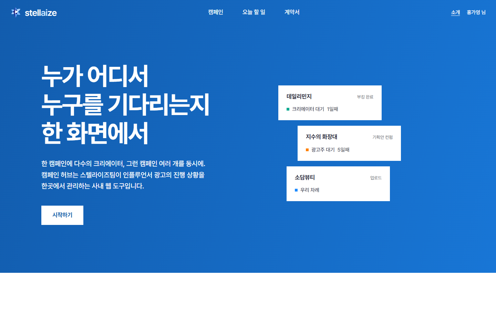
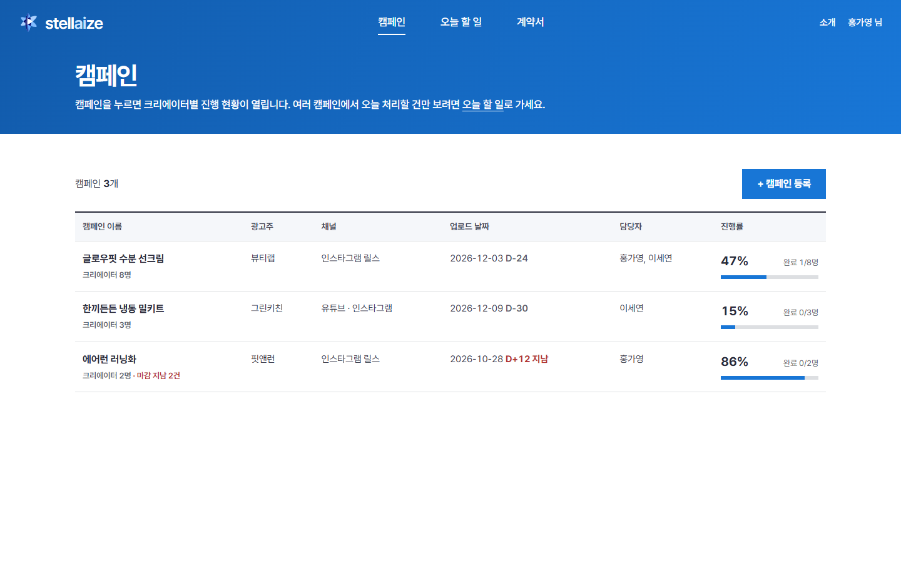
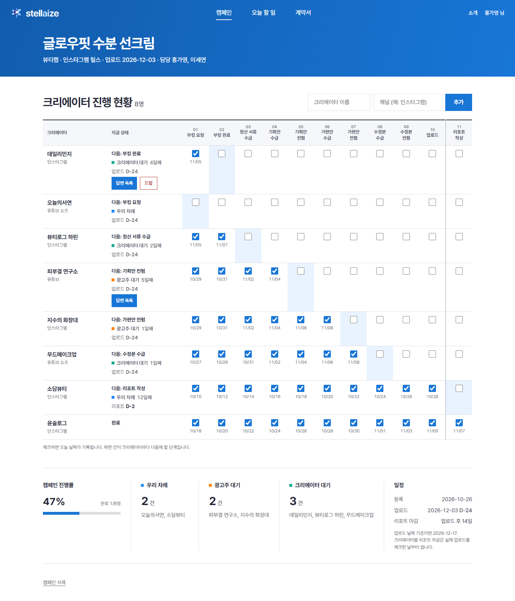
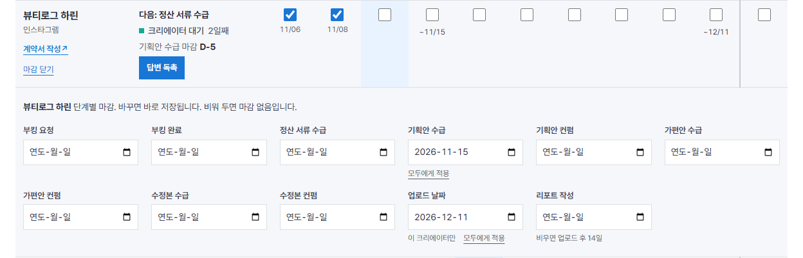
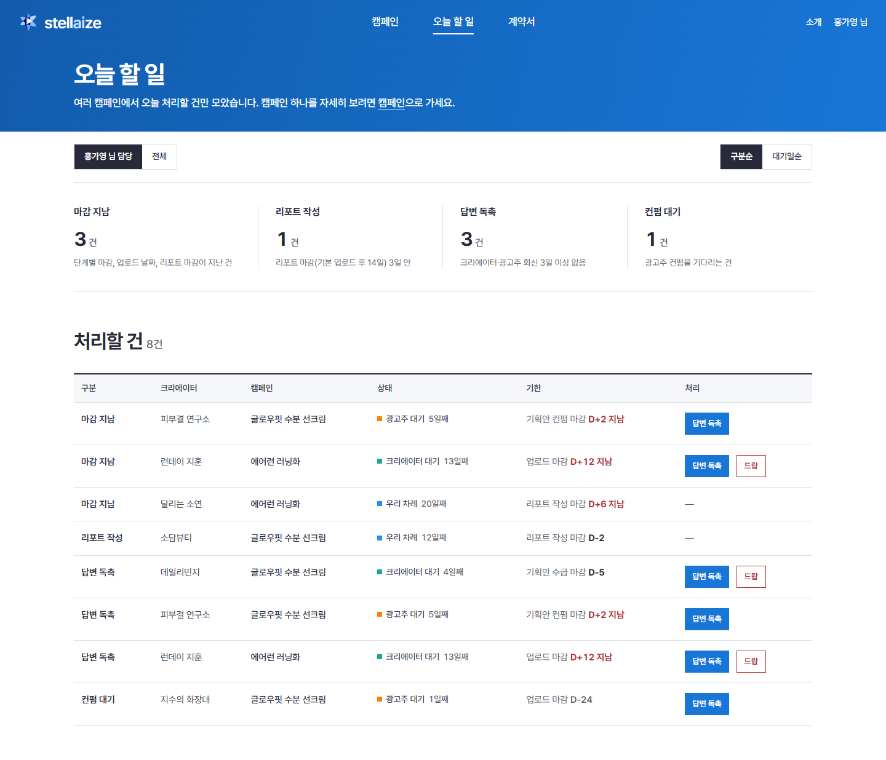
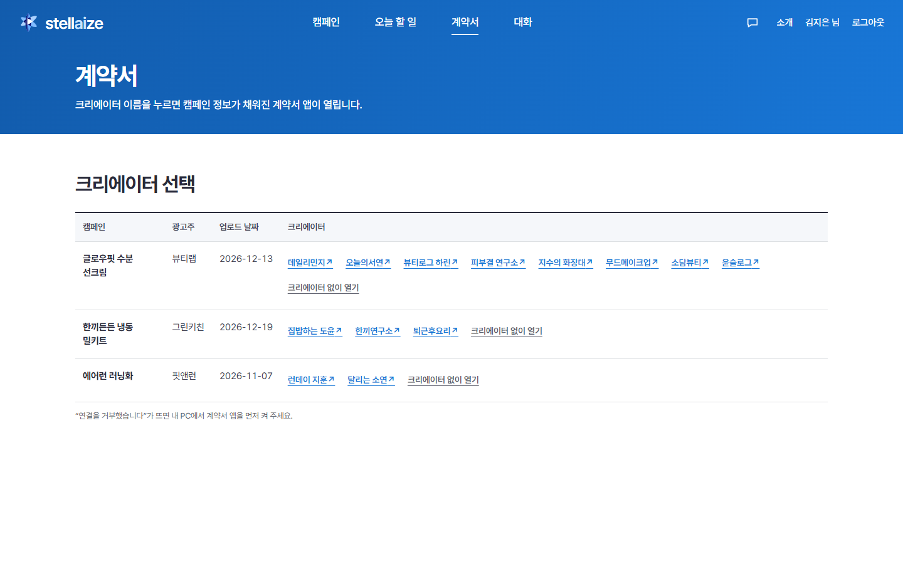
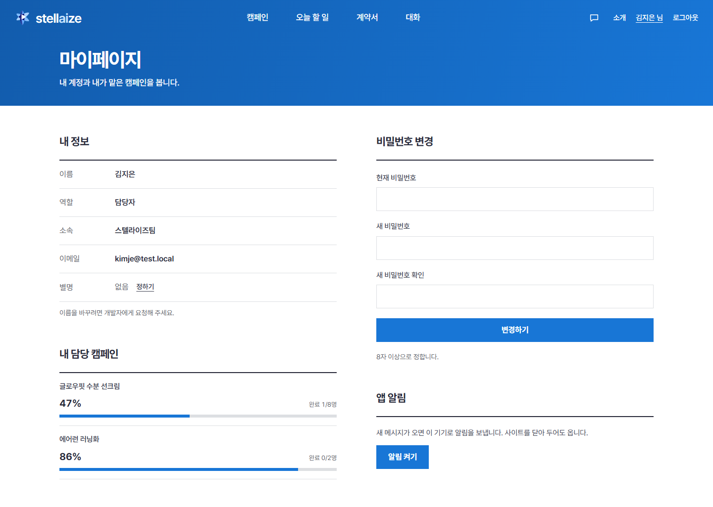

# 화면과 기능

허브의 화면마다 무엇을 하는지, 담당자와 크리에이터가 각각 무엇을 보는지 적은 문서다. 설치와 운영은 [setup.md](setup.md), 코드 구조는 [architecture.md](architecture.md).

## 화면 둘러보기

담당자의 상단 메뉴는 **캠페인 · 오늘 할 일 · 계약서** 세 개다. 오른쪽 위에 소개, 마이페이지, 로그아웃이 있다. 크리에이터에게는 **내 일정** 하나만 보인다. 개발자 계정은 담당자 메뉴에 **크리에이터 화면**이 하나 더 있다. 로그인 전에는 오른쪽 위에 소개와 로그인만 있고, 소개 화면 첫 구역 아래에 담당자·크리에이터 로그인 안내가 있다.

| 화면 | 주소 | 하는 일 |
|---|---|---|
| **소개** | `/about` (첫 화면) | 이 도구가 무엇인지, 스텔라이즈팀과 업무 흐름, 바뀌는 점. 처음 보는 사람용 |
| **캠페인** | `/campaigns` | 캠페인 **목록**(캠페인 이름, 광고주, 채널, 업로드 날짜, 담당자, 진행률)과 **캠페인 등록** |
| **캠페인 상세** | `/campaigns/glowfit` 등 | 맨 위에 **크리에이터 진행 현황 표**. 크리에이터마다 단계별 체크칸, 다음 단계, 대기 주체·일수, 마감. 아래에 진행률·대기 요약·일정 |
| **오늘 할 일** | `/today` | 여러 캠페인에서 오늘 처리할 건만 모은다: 마감 지남, 마감 임박(메일 보내기), 리포트 작성, 컨펌 대기. 마감 지난 건은 마감 지남 카드를 눌렀을 때만 목록에 나온다. "내 담당 / 전체" 필터, "구분순 / 대기일순" 정렬 |
| **계약서** | `/contracts` | 캠페인·크리에이터를 골라 계약서 앱 열기. 크리에이터 진행 표의 이름 아래 **계약서 작성** 링크도 같은 일을 한다 |
| **마이페이지** | `/mypage` | 내 정보, 내 담당 캠페인과 진행률, 비밀번호 변경 |
| **로그인 · 회원가입** | `/login`, `/signup` | 이메일과 비밀번호로 로그인. 회원가입은 로그인 화면의 버튼으로 간다. 담당자는 팀 가입 코드, 개발자는 개발자 코드로 가입 |
| **크리에이터 초대** | `/join?t=…` | 담당자가 만든 초대 링크. 크리에이터가 가입하면 그 캠페인의 자기 행에 연결된다 |
| **내 일정** (크리에이터) | `/creator` | 참여 캠페인의 단계·마감·상태, 기획안·가편안·수정본 링크 제출, 지난 마감 알림, 본인 최종단가·운송장, 배송 정보와 정산 서류 올리기. 개발자 계정으로 열면 크리에이터를 골라 보는 미리보기(보기 전용) |

**캠페인 등록:** 캠페인 목록의 **+ 캠페인 등록**에서 캠페인 이름, 광고주, 채널, 업로드 날짜, 담당자를 넣는다. 저장하면 그 캠페인 화면이 열리고, 크리에이터 이름과 채널을 넣어 추가한다. 여기서 넣는 업로드 날짜는 크리에이터 전원의 기본값이다.

**진행 체크:** 크리에이터마다 단계가 끝나면 체크한다. 체크한 날짜(한국 시간)가 칸 아래에 남는다. 아직 안 한 첫 단계가 "다음 단계"이고 파란 칸으로 표시된다. 다음 단계에 따라 대기 주체가 정해진다.
- 우리 차례: 부킹 요청, 리포트 작성
- 크리에이터 대기: 부킹 완료, 정산 서류 수급, 기획안·가편안·수정본 수급, 업로드
- 광고주 대기: 기획안·가편안·수정본 컨펌

대기 일수는 마지막으로 체크한 날부터 센다.

**단계별 마감·크리에이터별 업로드 날짜:** 크리에이터 이름 아래 **마감 설정**을 누르면 11단계 각각의 마감 날짜 칸이 열린다. 바꾸면 바로 저장되고, 체크칸 아래에 "~11/20"처럼 표시된다.
- 업로드 날짜를 넣으면 그 크리에이터만 그 날짜를 쓴다. 비워 두면 캠페인 업로드 날짜를 쓴다. 계약서 앱에도 이 날짜가 넘어간다.
- 리포트 작성은 비워 두면 업로드 체크일 + 14일이다.
- **모두에게 적용**을 누르면 같은 단계 마감을 캠페인의 다른 크리에이터에게도 넣는다(기획안 마감처럼 다 같은 경우).
- "지금 상태"에는 아직 체크 안 한 단계 중 가장 가까운 마감이 나온다.

**진행률:** 체크한 칸 수 ÷ (크리에이터 수 × 11단계). 드랍한 크리에이터는 빼고 계산한다. 옆에 모든 단계를 마친 인원("완료 1/8명")을 적는다.

**빨간색 = 마감이 지난 건만:** 아직 체크하지 않은 단계의 마감(단계별 마감, 업로드 날짜, 리포트 마감)이 지났을 때 빨간색으로 "D+n 지남"을 표시한다. 마감이 지나도 크리에이터는 진행 표에 그대로 있고, 지금 상태 칸에 빨간 경고가 뜬다(기획자 11/17). 업로드를 체크한 크리에이터는 **완료** 탭으로, 전원이 업로드한 캠페인은 캠페인 목록의 **완료** 탭으로 간다. 오늘 할 일에서는 마감 지난 건이 **마감 지남** 카드를 눌러야 나온다.

**드랍:** 크리에이터 회신을 기다리는 건에는 언제든 **[드랍]**이 나온다. "회신 3일 이상 없음" 기준과 "회신 지연" 목록은 기획자 요청(11/13)으로 뺐다. 하루만 늦어도 일정이 촉박해서, 늦은 건은 단계 마감으로 잡는다(마감 지남). 드랍은 한 번 더 확인한 뒤 빼고, 표 아래 "드랍" 목록에서 **되돌리기**할 수 있다.
- 답변 독촉 버튼(독촉한 날만 기록)은 기획자 요청(11/11)으로 뺐다. 알림을 보내지 않는 기록용이라 쓸 일이 없었다.

## 계정과 크리에이터 화면 (기획자 요청 2026-11-11)

기획자 요청: 크리에이터도 가입해서 들어오게, 기획안·가편안·수정본을 플랫폼에서 받게, 협의한 일정의 마감을 안 지키면 알림이 가게. 단, 크리에이터는 우리가 관리하는 화면은 못 보고 자기 할 일만.

**계정은 세 가지다.**

| 계정 | 가입 방법 | 보는 화면 |
|---|---|---|
| **담당자** | `/signup`의 가입 코드 칸에 **팀 가입 코드** | 캠페인, 오늘 할 일, 계약서, 마이페이지 |
| **개발자** | `/signup`의 가입 코드 칸에 **개발자 코드** | 담당자 화면 전부 + 크리에이터 화면 미리보기 |
| **크리에이터** | 담당자가 보낸 **초대 링크** | 내 일정 하나 |

- **담당자:** 가입할 때 넣는 이름이 캠페인 담당자 칸의 이름과 같아야 "내 담당"에 모인다.
- **개발자:** 허브를 만드는 사람용이다. 담당자와 똑같이 등록·체크할 수 있고, 상단 메뉴의 **크리에이터 화면**에서 크리에이터를 고르면 그 사람이 로그인했을 때 보는 내 일정이 나온다(아직 가입하지 않은 크리에이터도 고를 수 있다). 미리보기는 보기 전용이라 링크 제출은 할 수 없다. 제출까지 해 보려면 초대 링크를 시크릿 창에서 열어 크리에이터로 가입한다.
- **크리에이터:** 따로 가입할 수 없다. 담당자가 캠페인 상세의 크리에이터 행에서 **마감 · 초대 → 초대 링크 만들기**로 만든 주소를 보내고, 크리에이터가 그 주소에서 가입한다. 링크는 한 사람이 가입하면 더 쓸 수 없다. 이미 계정이 있는 크리에이터는 같은 링크에서 로그인해 캠페인을 추가한다.

**가입 코드는 허브를 설치한 사람이 정한다.** 화면에서 바꾸는 기능은 없다.
- 프로젝트 폴더의 `.env.local`에서 `STAFF_JOIN_CODE=`(팀 가입 코드)와 `DEV_JOIN_CODE=`(개발자 코드) 뒤의 값을 정한다. 저장하면 적용되고, 안 바뀌면 서버를 껐다 켠다.
- 정한 코드는 가입할 사람에게 따로 알려 준다. 가입할 때 한 번만 쓴다.
- 코드는 가입할 때만 확인한다. 코드를 바꿔도 이미 가입한 계정은 그대로다. 코드가 새어 나갔으면 바꾸면 된다.
- 값을 비워 두면 그 종류의 가입이 막힌다. 팀원이 모두 가입한 뒤 잠가 둘 때 쓴다.
- `.env.local`은 git에 올라가지 않는다. 다른 PC나 서버에 설치하면 거기서 새로 만든다.

**크리에이터가 보는 것:** 연결된 자기 행의 부킹 요청 ~ 업로드 단계, 단계별 마감과 D-day, 지금 누구 차례인지, 자기가 낸 링크뿐이다. 다른 크리에이터, 담당자 이름, 리포트 작성 단계, 다른 캠페인은 서버가 보내지 않는다. 담당자 화면 주소를 직접 쳐도 내 일정으로 돌아간다.

**링크 제출:** 크리에이터가 기획안·가편안·수정본 칸에 링크(드라이브, 유튜브 일부 공개 등)와 메모를 넣어 제출하면, 그 "수급" 단계가 오늘 날짜로 체크되고 담당자 표의 그 칸에 **제출본↗**이 붙는다. 다시 제출하면 "제출본 2"처럼 횟수가 보이고 가장 최근 링크가 열린다. 파일 자체는 허브에 올리지 않는다(영상 용량, 보관 비용).

**마감 알림:** 메일은 자동으로 나가지 않는다. 담당자가 오늘 할 일에서 **메일 보내기**를 눌러 양식을 확인하고 보낸다(아래 "마감 알림 메일"). 보낸 기록은 그 크리에이터의 마감 · 단가 · 초대 칸에 남는다. 마감을 넘기면 크리에이터의 내 일정 화면 위에 빨간 안내가 뜬다. 카톡 알림톡은 회사 명의 비즈니스 채널이 필요해 만들지 않았다.

**크리에이터가 실제로 들어오려면** 허브가 크리에이터도 열 수 있는 주소(https)에 떠 있어야 한다. 지금처럼 내 PC에서 켠 `localhost:3000`의 초대 링크는 같은 PC에서만 열린다.

### 소개 (첫 화면)


### 캠페인 목록


### 캠페인 상세
대기 주체는 작은 네모 색(■ 파랑 = 우리 차례, 주황 = 광고주 대기, 초록 = 크리에이터 대기)과 글자로 표시한다.



**마감 설정**을 연 모습 (단계별 마감, 이 크리에이터의 업로드 날짜)



### 오늘 할 일


### 계약서


### 마이페이지


---

## 단가·배송 정보·정산 서류 (기획자 답변 2026-11-14)

**담당자:** 캠페인 상세에서 크리에이터 이름 아래 **마감 · 단가 · 초대**를 열면 최종단가, PA 광고 1개월 단가, 운송장 번호 칸이 있다. 칸을 벗어나면 저장된다. PA 단가를 비워 두면 "단가 내 포함"이다. 그 아래에 크리에이터가 올린 성함·전화번호·배송 주소가 보이고, 신분증(또는 사업자등록증)과 통장사본을 내려받는다.

**크리에이터:** 내 일정 맨 위 **배송 정보 · 정산 서류**에서 성함, 전화번호, 주소, 서류 두 개를 올린다. 한 번 올리면 참여하는 모든 캠페인에 쓰인다. 캠페인 이름 아래에 본인 최종단가, PA 단가, 운송장이 보인다. 캠페인 예산과 다른 크리에이터의 정보는 서버가 보내지 않는다.

- 서류는 PDF·JPG·PNG, 파일 하나에 4MB까지(Vercel이 요청 하나를 4.5MB로 막아서, 화면이 파일을 하나씩 따로 보낸다). 파일 내용의 첫 부분으로 형식을 확인한다(이름만 .png인 파일은 거절).
- 서류 두 개가 모두 올라오면 그 크리에이터의 **정산 서류 수급** 단계가 자동으로 체크된다.
- **개인정보 수집·이용 동의**는 가입할 때가 아니라 이 화면에서 처음 저장할 때 받고, 동의한 시각을 남긴다. 문구는 우리가 쓴 초안이다(`components/CreatorProfile.tsx`). **실제 크리에이터가 쓰기 전에 회사 확인이 필요하다**: 수집 주체 이름, 보관 기간(지금 "정산이 끝난 날부터 5년").
- 크리에이터는 **내 정보 삭제**로 배송 정보와 서류를 모두 지울 수 있다.
- 서류 파일은 주소로 직접 열리지 않는다. `/api/files`가 요청한 사람을 확인한 뒤 내려 준다(담당자는 전부, 크리에이터는 자기 것만). Supabase를 연결했으면 비공개 보관함(Storage의 `creator-docs`, 처음 올릴 때 자동으로 만들어진다)에, 아니면 `data/files/`에 저장된다.

## 대외비 캠페인 (2026-11-14, 우리가 정한 규칙)

- 캠페인 등록 때 **대외비 캠페인**을 체크하거나, 캠페인 상세 맨 아래에서 담당자가 **대외비로 바꾸기**를 누른다.
- 대외비 캠페인은 **담당자 칸에 이름이 있는 계정에게만** 서버가 보낸다. 다른 팀원에게는 목록, 오늘 할 일, 계약서 화면, 제출 링크, 알림 어디에도 나오지 않고, 주소를 알아도 바꿀 수 없다. 개발자 계정도 담당자가 아니면 못 본다.
- 대외비를 걸거나 푸는 것은 그 캠페인의 담당자만 할 수 있다.
- 참여하는 크리에이터는 지금처럼 자기 줄만 본다.
- 한계: 담당자를 **이름**으로 맞춘다. 담당자 칸의 이름과 계정 이름이 한 글자라도 다르면 본인도 못 보고, 같은 이름으로 가입한 다른 계정은 볼 수 있다. 실제 대외비 자료를 넣기 전에 계정으로 연결하도록 바꾼다(`lib/campaigns.ts`의 `canSee`).

## 마감 알림 메일 (기획자 답변 2026-11-13, 11/14 방식 변경)

**자동으로 나가지 않는다.** 담당자가 버튼을 눌러 내용을 확인하고 보낸다.

1. **오늘 할 일**의 **마감 임박** 칸에 크리에이터 차례이고 마감이 3일 안인 건이 모인다. 마감이 지난 건은 **마감 지남** 카드에 있다.
2. 그 줄의 **메일 보내기**를 누르면 줄 아래에 양식이 열린다. 받는 사람(크리에이터 계정 메일), 참조(소속사 담당자 메일), 제목, 내용이 미리 채워져 있다.
3. 고칠 곳을 고치고 **보내기**를 누른다. 보낸 날이 그 크리에이터의 **마감 · 단가 · 초대** 칸에 남는다.

- 미리 채워지는 문구는 마감까지 남은 날에 따라 "마감이 내일(11/19)입니다", "오늘", "3일 뒤", "마감(11/19)이 지났습니다"로 바뀐다(`lib/campaigns.ts`의 `reminderDraft`).
- 팀 메일(`MAIL_CC`)은 양식에 적지 않아도 항상 참조로 들어간다(팀 규칙). 우리 쪽 캠페인 담당자는 참조에 넣지 않는다.
- 크리에이터가 아직 가입하지 않았으면 받는 사람이 비어 있다. 주소를 직접 넣어 보낼 수 있다.

**보내려면** `.env.local`에 아래를 넣고 허브를 다시 켠다. 비워 두면 양식은 열리지만 보내기를 눌러도 나가지 않고, 양식 위 설명 상자에 그 안내가 나온다.

```
RESEND_API_KEY=발송 서비스 키
MAIL_FROM=스텔라이즈팀 <보내는주소@회사도메인>
MAIL_CC=팀메일주소
```

- 발송은 [Resend](https://resend.com)를 쓴다. 보내는 주소의 **도메인을 Resend에 등록**(DNS 설정)해야 크리에이터에게 보낼 수 있어서, 회사 도메인으로 보내려면 회사 IT의 도움이 필요하다. 회사가 메일함(SMTP 로그인)을 주는 쪽이면 `lib/server/mail.ts` 한 곳을 바꾼다.
